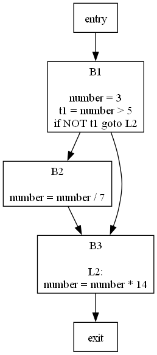

# Advanced Compiler Project

A three-phase compiler front-end for a subset of **Java**, built with **ANTLR 4** and **Python 3**. It goes from source code to a parse tree, then to three-address code (TAC), and finally to a control flow graph (CFG) rendered with Graphviz.

| Phase | Goal | Output |
|---|---|---|
| [Phase 1](Phase1) | Lexing and parsing with an ANTLR Java grammar | Parse tree |
| [Phase 2](Phase2) | Syntax-directed translation via grammar **action rules** | Three-address code |
| [Phase 3](Phase3) | Leader detection, basic blocks and successor edges | Control flow graph (`.png`) |

## Example

Input — [`Phase3/tests/if_statement_test.java`](Phase3/tests/if_statement_test.java):

```java
int number = 3;
if (number > 5) {
    number = number / 7;
    System.out.println("Number is greater than 5. Dividing by 7: " + number);
}
number = number * 14;
```

Three-address code produced by the action rules:

```
number = 3
t1 = number > 5
if NOT t1 goto L2
number = number / 7
L2:
number = number * 14
```

Control flow graph built in Phase 3:

<p align="center">
  
</p>

## How it works

### Phase 1 — Parse tree
The ANTLR grammars `JavaLexer.g4` and `JavaParser.g4` are compiled into a Python lexer and parser (`gen/`). `main.py` tokenises the input file, parses it from the `compilationUnit` rule and prints the parse tree.

### Phase 2 — Three-address code
Action rules embedded in `JavaParser.g4` (`@parser::members` plus `{...}` actions and `returns [val]` attributes) generate TAC while the parser runs. Temporaries (`t1`, `t2`, …) and labels (`L1`, `L2`, …) are created on demand. Supported constructs:

- variable declarations and assignments, including compound operators (`+=`, `-=`, …)
- arithmetic and relational expressions
- pre/post increment and decrement
- `if` / `else`, `while` and `for` statements

### Phase 3 — Control flow graph
The generated instructions ([`instruction.py`](Phase3/instruction.py)) are split into basic blocks ([`block.py`](Phase3/block.py)) using the classic leader algorithm:

1. The first instruction is a leader.
2. The target of any jump is a leader.
3. The instruction right after a jump is a leader.

Each leader starts a new block; successor edges are added for fall-through and branch targets, plus `entry` and `exit` nodes. The graph is drawn with the `graphviz` package and saved to `graph/CFG.png`.

### Test — Action rules guide
[`Test/`](Test) contains a small `Expr` grammar showing how to write action rules that emit TAC for arithmetic expressions — a minimal reference for the technique used in Phases 2 and 3.

## Getting started

### Prerequisites
- Python 3.11+
- [Graphviz](https://graphviz.org/download/) installed on your system (needed for Phase 3)
- Optional: ANTLR 4.13.1 (only if you want to regenerate the parsers from the `.g4` files)

### Install

```bash
git clone https://github.com/Nzzznin/Advanced_Compiler_Project.git
cd Advanced_Compiler_Project
pip install -r requirements.txt   # antlr4-python3-runtime, graphviz
```

### Run

```bash
# Phase 1 — run from inside the Phase1 folder
cd Phase1
python main.py -n tests/for_statement_test.java
cd ..

# Phase 2 and Phase 3 — run as modules from the repository root
python -m Phase2.main -n Phase2/tests/while_statement_test.java
python -m Phase3.main -n Phase3/tests/if_statement_test.java
```

Each `tests/` folder has sample inputs for assignments, `if`, `while` and `for` statements.

> **Note:** `Phase3/main.py` adds `C:\Program Files\Graphviz\bin` to `PATH`. On another OS or install location, make sure the Graphviz `dot` binary is on your `PATH`.

### Regenerating the parser

```bash
cd Phase2
antlr4 -Dlanguage=Python3 -visitor -o gen JavaLexer.g4 JavaParser.g4
```

## Project structure

```
Advanced_Compiler_Project/
├── Phase1/            # Parse tree
│   ├── JavaLexer.g4, JavaParser.g4
│   ├── gen/           # ANTLR-generated lexer/parser
│   ├── tests/         # Sample Java inputs
│   └── main.py
├── Phase2/            # Three-address code generation (action rules in JavaParser.g4)
├── Phase3/            # Control flow graph
│   ├── block.py       # Basic block
│   ├── instruction.py # TAC instruction
│   └── graph/         # Rendered CFG
├── Test/              # Action-rule examples on a small Expr grammar
└── requirements.txt
```
